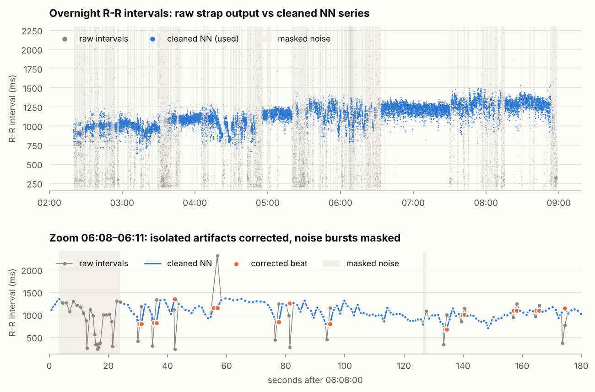
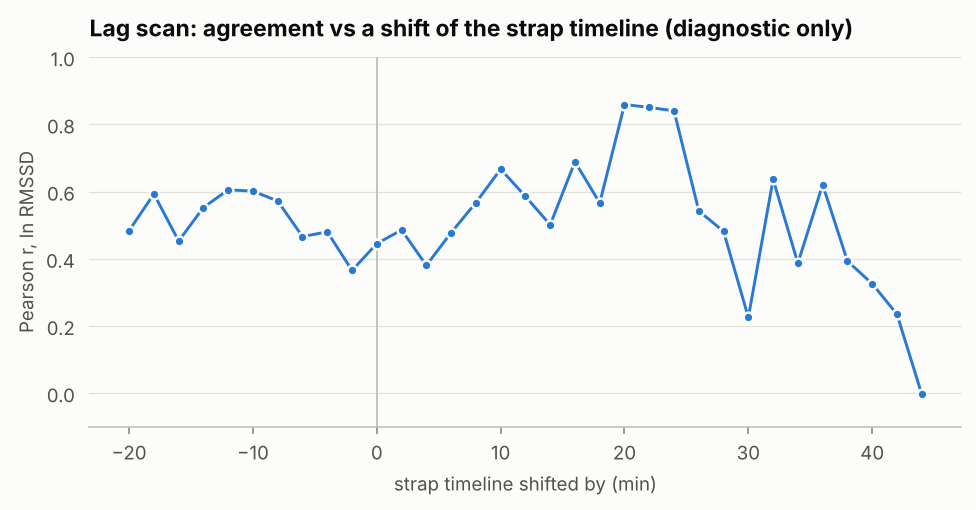
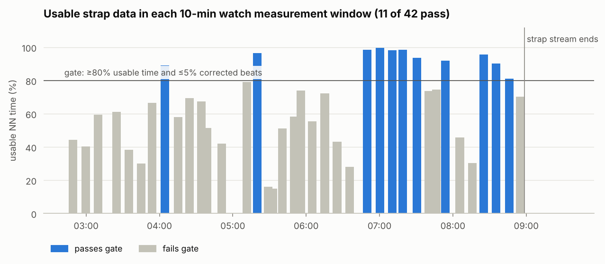
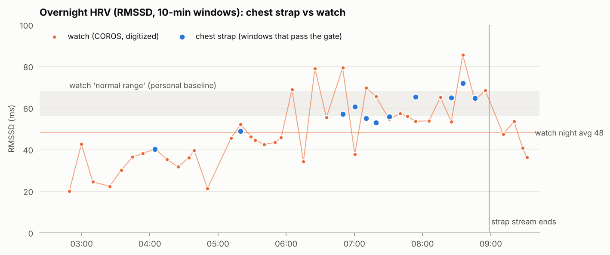
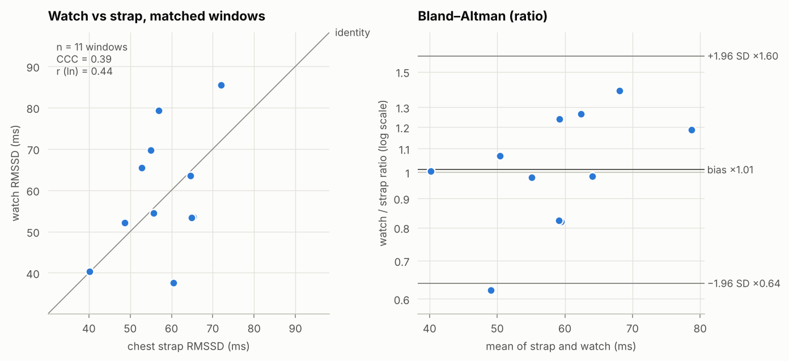
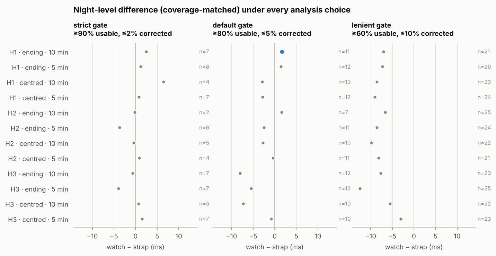
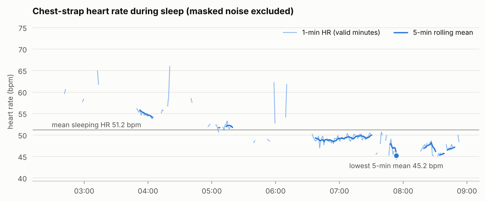

# Chest strap vs COROS watch — Overnight HRV and resting heart rate, 2026-04-17

_Generated by hrvcompare. Every number and figure is produced by the pipeline; re-run it to regenerate this report (see [Reproduce](#reproduce))._

## Key results

|  | Result |
|---|---|
| Strap data usable during sleep | 64% of 02:29–08:58 (37% of the recording masked as noise, 3.0% of usable beats corrected) |
| Watch nightly HRV | 48 ms reported; 48.0 ms from the digitized chart (42 readings) |
| **Night level, same windows** | **H1 (strap clock as recorded): watch 59.5 vs strap 57.9 ms → +1.7 ms (+2.9%)**, n = 11 · H2: +1.6 ms (n = 7) · H3: −8.0 ms (n = 12) |
| Night level, every strict/default-gate variant | −8.0 to +6.5 ms (24 variants: 3 alignment hypotheses × 2 gates × 2 window conventions × 2 window lengths) |
| Single readings (epoch level) | ratio watch/strap ×1.01, 95% limits ×0.64–×1.60, CCC 0.39, r(ln) 0.44 |
| Watch noise per reading | ≈11.9 ms SD on top of the strap's own variation → ≈1.8 ms on the nightly mean |
| Strap resting HR | lowest 5-min mean 45.2 bpm · lowest 30-min mean 46.6 bpm · mean sleeping HR 51.2 bpm |
| Watch resting HR | not provided — re-run with `--watch-rhr <bpm>` to add the comparison |

> **Bottom line.** Averaged over the same stretches of the night, the watch's *nightly* HRV agrees with the chest strap to within 8 ms (14%) whichever way the strap's clock is aligned (−8.0 to +1.7 ms across the three clock hypotheses). Its *individual 10-minute readings* scatter far more than the strap does, so treat single readings as noisy and trust the nightly average. The watch's headline 48 ms covers the whole night, while the usable strap windows do not: comparing it with the strap's usable-window average (57.9 ms) without matching coverage would wrongly suggest the watch reads 10 ms low.

## 1. Data

| Source | What it contains |
|---|---|
| Chest strap | `strap_rri_20260417.csv` — device BRT30969 (fw 1.7.9), 23,816 R-R intervals, session 02:19:50 + 07:21:03 |
| Watch | `coros_hrv_20260417.png` — COROS 'HRV Assessment' screenshot: night avg 48 ms, normal range 56–68 ms, sleep 02:29–09:37 |

COROS measures overnight HRV as **RMSSD** roughly every **10 minutes** during sleep and reports the night's average; its 'normal range' is a personal baseline from previous nights. The strap is therefore summarised the same way: RMSSD in the 10 minutes ending at each watch reading.

## 2. Cleaning the strap RRI series without breaking it

### 2.1 Why deleting outliers breaks HRV

* **RMSSD** is the RMS of *successive* differences. Delete beat *i* and the next difference becomes RR(i+1) − RR(i−1): two intervals that were never adjacent. Every deletion adds a spurious jump and inflates RMSSD.
* **Spectral measures** (LF/HF) assume a continuous beat sequence; deleting beats shifts all later beat times.
* **Interpolating over long noise runs** fixes the arithmetic but makes up data — a 9-beat burst "corrected" by a spline is a guess.

### 2.2 What the pipeline does instead

1. **Physiological range**: intervals outside 400–2000 ms (30–150 bpm, appropriate for sleep) are flagged.
2. **Beat classification** with the Lipponen & Tarvainen (2019) algorithm (the Kubios 'automatic' method). Each flagged beat is classified as *ectopic*, *missed*, *extra* or *long/short* using adaptive thresholds (α = 5.2, 91-beat window).
3. **Safety net for dense noise**: any beat more than 30% away from a robust local median is flagged too, and flagged beats are kept out of the threshold statistics. In this recording, garbage stretches otherwise inflate the adaptive thresholds so much that obvious junk (e.g. 342 ms inside a 1300 ms rhythm) passes.
4. **Noise bursts are masked, not corrected**: where ≥3 of any 10 consecutive beats are flagged, the run (±2 beats) is marked unusable. Masked intervals **keep their duration on the time axis**, so the timeline stays continuous and every window knows how much of it is unusable.
5. **Isolated artifacts are corrected by type**, in a way that preserves total elapsed time exactly:
   * *extra* detection → merged with the neighbour whose sum best matches the local median;
   * *missed* beat → split into k equal intervals;
   * *ectopic* / *long-short* → the R-peak shared by a pair of intervals is moved to their midpoint (the pair whose mean best matches the median).
6. **Residual check**: detection is re-run on the corrected series; anything still flagged is masked.
7. **Metrics only from clean adjacency**: RMSSD/pNN50 use successive differences only where *both* intervals are usable. LF/HF use a Lomb–Scargle periodogram on the unevenly spaced usable beats, so masked gaps never need interpolating.
8. **Window gate**: a window counts only if ≥80% of its time is usable NN and ≤5% of its beats were corrected (the conventional ≤5% correction limit).

### 2.3 Result on this recording

|  | Count |
|---|---|
| Raw intervals | 23,816 |
| Masked (noise bursts, unresolvable beats) | 10,484 intervals · 147 min · 37% of recording time |
| Corrected (isolated artifacts) | 401 intervals (3.0% of usable): extra 74, missed 10, ectopic 216, longshort 101 |
| Untouched | 12,859 |
| Total time before → after | 23930.877 s → 23930.877 s (identical) |
| Device's own 'unusual' flag | 894 beats; we also flag 99% of them, but they cover only 8% of what we flag — not usable as a filter |



*Figure 1. Raw strap intervals (grey) and the cleaned NN series that enters the analysis (blue); shaded spans are masked noise. Bottom: a 3-minute zoom in which isolated artifacts are corrected in place (orange) and a noise burst is masked rather than interpolated.*

**Validation on synthetic data with known truth** (sleep-like RR with respiratory sinus arrhythmia, 2% injected ectopic/missed/extra beats plus 3 noise bursts, 3 random seeds):

| seed | ectopic found | missed found | extra found | bursts masked | RMSSD true | uncleaned | cleaned | false flags (clean data) |
|---|---|---|---|---|---|---|---|---|
| 0 | 100% of 22 | 100% of 22 | 100% of 16 | 100% | 39.5 | 172.3 | 38.8 | 2.4% |
| 1 | 100% of 22 | 100% of 17 | 100% of 21 | 100% | 39.6 | 165.9 | 38.9 | 1.9% |
| 2 | 100% of 20 | 100% of 12 | 100% of 28 | 100% | 40.1 | 156.4 | 39.2 | 2.8% |

False flags on artifact-free data come from the Kubios thresholds themselves (NeuroKit2's implementation flags a similar number); they cost about 2% of RMSSD.

## 3. Aligning the two devices in time

The strap has **no independent clock**: its `Time` column is exactly `start + cumsum(RRI)`. The header says the session ran 07:21:03 (02:19:50–09:40:53), but the intervals add up to only 06:38:50, ending at 08:58:40. **42.2 minutes of wall-clock time contain no beats**, and nothing in the RRI file says where. Three hypotheses are carried through the whole analysis:

|  | Where the missing time is |
|---|---|
| H1 | strap clock taken as recorded; the RR stream ended early and the session ran on empty |
| H2 | missing time spread uniformly (linear stretch) |
| H3 | missing time inside masked artifact episodes |

**Where did the time go?** The evidence points both ways.

*For time lost inside the night (H2/H3):*

* no interval longer than 3.03 s appears in the file, so a contact loss longer than that leaves no interval and its time silently vanishes, and 37% of the recording is contact noise;
* the strap's final 5 minutes are 96% noise. With drift (H2/H3) they fall at 09:34–09:40, when the watch says you woke (09:37) and the session was stopped (09:40), which fits getting up and taking the strap off. Without drift (H1) they fall at 08:53–08:58, in the middle of sleep;
* in the exploratory lag scan below, agreement is highest when the strap timeline is shifted by +20 min (r = 0.86, n = 13; unshifted r = 0.44, n = 11), i.e. with the strap's clock running behind the wall clock — what H2/H3 predict.

*For an early end of the stream (H1):*

* the last usable strap minutes before that final noise look like stable sleep (HR ≈ 48 bpm, RMSSD ≈ 77 ms), not the arousal that usually precedes waking.

So the strap's clock probably runs tens of minutes behind in the second half of the night, but by how much cannot be pinned down from one night without a sync marker. **The figures and window-level tables use H1**, the strap's clock as recorded, because it needs no assumption about where the beats went. **Every headline number is also given under H2 and H3.** **No offset is fitted**: choosing a shift by HRV agreement and then reporting HRV agreement would be circular.



*Figure 2. Correlation between strap (H1 clock) and watch ln RMSSD when the strap timeline is shifted by −20 to +44 min. A positive shift means the strap's clock runs behind the wall clock. The shift is not applied, because it would be chosen on the very agreement being measured.*

## 4. Reading the watch values off the screenshot

* **y-axis**: the 0/50/100/150 ms gridlines were detected at rows 408, 484, 560, 635.5 → 1.517 px per ms (1 px ≈ 0.66 ms).
* **x-axis**: the baseline spans 02:29 (sleep onset) to 09:37 (wake), as labelled.
* **readings**: the line is a polyline whose corners are the watch's measurements. A free-knot fit recovers **42 readings** (the fitted polyline matches the drawn line to 0.60 px RMS). They are **not evenly spaced**: the median spacing is 10.1 min, with 2 gaps longer than 15 min (skipped measurements). Sampling the line on a regular grid instead would read values off the straight segments between readings.
* **check**: the mean of the digitized readings is **47.98 ms vs the app's 48 ms**.

## 5. HRV agreement



*Figure 3. Share of each watch measurement window covered by usable strap NN intervals. Only windows that pass the quality gate (blue) are compared.*

Of the 42 watch readings, **11** have a strap window that passes the gate. In the first half of the night only 2 of 20 windows survive strap noise. The usable windows are concentrated in the second half of the night.



*Figure 4. Overnight RMSSD: the watch's digitized readings (orange) and the strap's 10-minute RMSSD for windows that pass the gate (blue). The grey band is the watch's personal normal range; the vertical line marks where the strap's beat stream ends.*

### 5.1 Night level (main comparison)

With the strap's clock as recorded (H1):

|  | RMSSD (ms) | based on |
|---|---|---|
| Watch, app-reported night average | 48 | all readings |
| Watch, digitized night average | 48.0 | all readings |
| Watch, average over matched readings | 59.5 | 11 readings |
| Strap, average over the same windows | 57.9 | 11 windows |
| **Difference (watch − strap)** | **+1.7** | ratio ×1.029 |

Under each clock hypothesis (same gate and windows; the hypothesis decides which watch readings are matched, and to which stretch of strap data):

| clock | n | watch (ms) | strap (ms) | watch − strap (ms) | ratio | r (ln), epochs | MAE (ms), epochs |
|---|---|---|---|---|---|---|---|
| H1 | 11 | 59.5 | 57.9 | +1.7 | ×1.03 | 0.44 | 10.5 |
| H2 | 7 | 55.9 | 54.4 | +1.6 | ×1.03 | 0.90 | 5.3 |
| H3 | 12 | 48.5 | 56.5 | −8.0 | ×0.86 | 0.29 | 9.5 |

### 5.2 Epoch level (secondary)



*Figure 5. Left: watch vs strap RMSSD for the matched windows, with the identity line. Right: Bland–Altman plot on the ratio (log) scale with the bias and 95% limits of agreement.*

| Statistic | Value |  |
|---|---|---|
| Bias (watch − strap) | +1.7 ms | ratio ×1.011 |
| 95% limits of agreement | −24.9 to +28.2 ms | ×0.64 to ×1.60 |
| Lin's CCC | 0.39 | ln scale 0.40 |
| Pearson r (ln RMSSD) | 0.44 | 95% CI −0.21 to 0.82, p = 0.170 |
| Spearman ρ | 0.29 |  |
| MAE / MAPE | 10.5 ms | 18% |

The watch readings vary more than the strap's (14.9 vs 8.9 ms SD over the matched windows). That is ≈11.9 ms of extra scatter per reading, consistent with each COROS reading being a short optical sample. Averaged over 42 readings it shrinks to ≈1.8 ms on the nightly mean, which is why the nightly average is far more trustworthy than any single reading. Shorter strap windows don't materially improve the match, so window length isn't the explanation:

| strap window | convention | n | night diff (ms) | r (ln) | CCC | MAE (ms) | SD strap | SD watch |
|---|---|---|---|---|---|---|---|---|
| 1 min | ending | 17 | −4.2 | 0.46 | 0.28 | 14.0 | 15.3 | 16.2 |
| 1 min | centred | 15 | −4.5 | 0.17 | 0.17 | 13.0 | 14.8 | 15.0 |
| 2 min | ending | 17 | −11.0 | −0.31 | −0.27 | 19.9 | 16.3 | 15.1 |
| 2 min | centred | 13 | −0.3 | 0.59 | 0.53 | 9.4 | 12.1 | 15.7 |
| 3 min | ending | 13 | +0.0 | 0.36 | 0.25 | 11.8 | 8.3 | 14.8 |
| 3 min | centred | 13 | −2.7 | 0.48 | 0.42 | 11.3 | 10.9 | 15.5 |
| 5 min | ending | 12 | +1.4 | 0.44 | 0.34 | 10.9 | 8.3 | 15.0 |
| 5 min | centred | 12 | −2.8 | 0.33 | 0.23 | 13.1 | 10.9 | 15.6 |
| 10 min | ending | 11 | +1.7 | 0.44 | 0.39 | 10.5 | 8.9 | 14.9 |
| 10 min | centred | 13 | −2.9 | 0.39 | 0.30 | 12.4 | 8.8 | 15.7 |

Epoch-level agreement also depends on the clock: across the three hypotheses r (ln) ranges from 0.29 to 0.90 (table in the previous subsection). 10-minute epochs from one night are few and autocorrelated, and their alignment is uncertain, so treat the epoch statistics as descriptive, not as a validation.

## 6. Sensitivity analysis



*Figure 6. Night-level difference (watch − strap) over coverage-matched windows for every combination of alignment hypothesis, window convention, window length and quality gate. The analysis used in the other figures is highlighted; n is the number of matched windows.*

Across the 24 strict- and default-gate variants, the night-level difference stays between **−8.0 and +6.5 ms** (median −0.4 ms). With the **lenient** gate it moves to −12.5 … −3.1 ms (median −8.0 ms): leftover artifacts in poorly covered windows inflate the strap's RMSSD and make the watch look low. Quality gating matters more than any alignment choice. Full grid: [`tables/sensitivity_grid.csv`](tables/sensitivity_grid.csv).

## 7. Resting heart rate



*Figure 7. Strap heart rate during sleep from usable beats only: per-minute values and the 5-minute rolling mean, with the lowest 5-minute mean marked.*

COROS doesn't publish exactly how its resting HR is computed, so several standard strap definitions are reported. Compare the watch's RHR against the one that matches its definition (most wearables report a sleep-time low such as the lowest 5–30-min average):

| Definition (strap) | bpm |  |
|---|---|---|
| Lowest 5-min mean HR | 45.2 | window ending 07:56 |
| Lowest 30-min mean HR | 46.6 | window ending 08:45 |
| Mean sleeping HR | 51.2 | all usable minutes |
| 5th percentile of 1-min HR | 45.5 |  |
| Lowest 1-min HR | 44.3 |  |

Based on 174 of 389 sleep minutes with ≥80% usable beats. HR is much less sensitive to artifacts than HRV: a masked minute is simply skipped.

## 8. Strap-only overnight HRV summary

From 21 of 77 5-min windows passing the gate between 02:29 and 08:58 (Task Force 1996 short-term standard; frequency domain via Lomb–Scargle):

| Metric | Value | Unit |
|---|---|---|
| Mean NN | 1222 | ms |
| HR | 49.2 | bpm |
| SDNN (5-min) | 57.3 | ms |
| RMSSD (5-min) | 57.5 | ms |
| pNN50 | 40.7 | % |
| LF power | 1005 | ms² |
| HF power | 1481 | ms² |
| LF/HF | 0.66 |  |

RMSSD pooled over every usable beat pair of the night is 64.7 ms. It is higher than the gated window average because it includes the edges of poorly covered windows; the gated windows are the more robust estimate.

## 9. Limitations

* **One night, one person.** Agreement statistics from about 11 autocorrelated windows are descriptive. A validation needs several nights (ideally several people) and a nightly-level Bland–Altman across nights.
* **Strap signal quality** is the dominant problem: only 64% of the sleep window was usable, and only 11 of 42 watch readings could be matched.
* **Clock**: the 42-min deficit cannot be located from the RRI data. The night-level difference spans −8.0 to +1.7 ms across the clock hypotheses, and window-by-window matching is uncertain by up to tens of minutes late in the night.
* **COROS internals** (measurement duration within each 10-min slot, artifact handling, RHR definition) are not published.
* **Screenshot digitization**: ±1 px ≈ ±0.7 ms in value and ≈ ±1 min in time per reading.

## 10. Protocol for the next nights

1. **Wet the strap electrodes** (or use electrode gel) and tighten the strap. Contact noise made 37% of this recording unusable.
2. **Start both devices within the same minute** and note the time; stop the strap recording as soon as you wake.
3. **Add sync markers**: 5 slow deep breaths, or 10 s of standing still after sitting up, at the start and end. Both devices show these as a clear HR/RR change.
4. **Log when the strap is taken off.** It resolves the clock-deficit question directly.
5. **Export the watch data** if possible (COROS app → activity/sleep → export FIT, or a third-party sync). Numeric data removes digitization error and gives the watch's HR curve, which allows HR-based alignment that is independent of HRV.
6. Record **at least 5–7 nights** and compare nightly averages.

## Reproduce

```bash
pip install -e .
hrvcompare run --rri data/raw/strap_rri_20260417.csv \
  --watch-png data/raw/coros_hrv_20260417.png \
  --sleep 02:29 09:37 \
  --watch-avg 48 \
  --watch-range 56 68 \
  --out reports
```

Tables written alongside this report:

* [`tables/cleaned_rr.csv`](tables/cleaned_rr.csv)
* [`tables/matched_windows.csv`](tables/matched_windows.csv)
* [`tables/strap_5min_windows.csv`](tables/strap_5min_windows.csv)
* [`tables/sensitivity_grid.csv`](tables/sensitivity_grid.csv)
* [`tables/lag_scan.csv`](tables/lag_scan.csv)
* [`tables/window_length_scan.csv`](tables/window_length_scan.csv)
* [`tables/synthetic_validation.csv`](tables/synthetic_validation.csv)
* [`tables/watch_digitized.csv`](tables/watch_digitized.csv)
* [`tables/strap_hr_per_minute.csv`](tables/strap_hr_per_minute.csv)
* [`tables/cleaning_summary.csv`](tables/cleaning_summary.csv)

## References

* Lipponen JA, Tarvainen MP (2019). A robust algorithm for heart rate variability time series artefact correction using novel beat classification. *J Med Eng Technol* 43(3):173–181.
* Task Force of the ESC and NASPE (1996). Heart rate variability: standards of measurement, physiological interpretation and clinical use. *Circulation* 93:1043–1065.
* Bland JM, Altman DG (1999). Measuring agreement in method comparison studies. *Stat Methods Med Res* 8:135–160.
* Lin LI (1989). A concordance correlation coefficient to evaluate reproducibility. *Biometrics* 45:255–268.
* COROS support: Overnight HRV — RMSSD measured over 10-minute intervals during sleep and averaged nightly.
